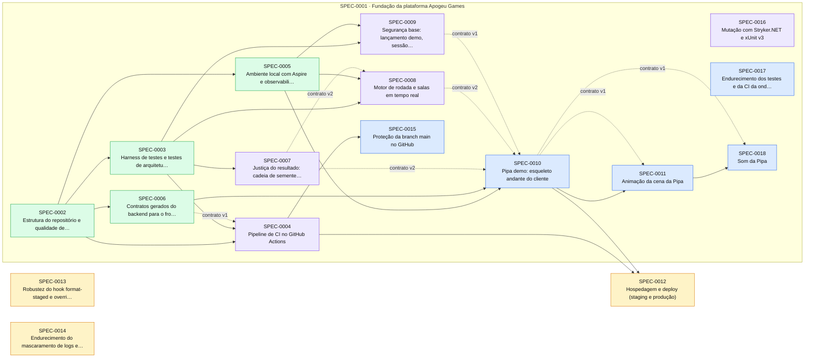

# Índice de Specs

> Gerado por `spec_graph.py index` em 2026-10-09 — não edite manualmente.

## Saúde

- Validação (G0): **1 erro(s), 5 aviso(s)** — rode `spec_graph.py validate`
- Specs: proposed 3, approved 5, in-progress 5, implemented 4
- Impedimentos: **1 aberto(s)**, 4 resolvido(s)

## Impedimentos Abertos

| Spec | ID | Tipo | Fase/Gate | Responsável | Aberto em | Idade | Descrição |
|---|---|---|---|---|---|---|---|
| SPEC-0015 | IMP-01 | externo | G1 | thomas: GitHub Pro ou repositório público | 2026-10-09 | 0d | Branch protection e rulesets indisponíveis no GitHub Free para repositório privado (API 403) |

## Cobertura de Pilares

Perfil: **rigoroso**

| Pilar | Situação | Detalhe |
|---|---|---|
| Arquitetura e fronteiras | coberto | ADR-0001, ADR-0004 |
| Estratégia de testes | coberto | ADR-0009 |
| Qualidade de código | coberto | ADR-0012 |
| Entrega contínua e ambientes | coberto | ADR-0013 |
| Fluxo de mudança | coberto | ADR-0011 |
| Segredos e dados sensíveis | coberto | ADR-0014 |
| Identidade e acesso | coberto | ADR-0015 |
| Dependências e ciclo de vida da stack | coberto | ADR-0016, ADR-0022 |
| Observabilidade | coberto | ADR-0017 |
| Resiliência e recuperação | coberto | ADR-0018 |
| Dados e migrações | coberto | ADR-0010 |
| Custo | dispensado | Fase pessoal só com validação local, sem hospedagem nem serviços pagos (decisão do usuário, 2026-10-07). Reabrir na spec 'Hospedagem e deploy' com estimativa atual/2x/10x. |
| Desempenho e escala | coberto | ADR-0019 |
| Acessibilidade e conformidade | coberto | ADR-0020 |

## Jornadas Críticas

| Jornada | Situação | Specs |
|---|---|---|
| Jogador abre o jogo pelo operador, aposta e faz cash-out antes do crash, com saldo atualizado na carteira | descoberta | — |
| Jogador aposta, a rodada crasha antes do cash-out e a aposta é liquidada como perdida | descoberta | — |
| Jogador verifica uma rodada encerrada pelo hash/semente e obtém o mesmo ponto de crash | planejada | SPEC-0010 |

## Plano de Execução

**Em andamento:** SPEC-0004, SPEC-0007, SPEC-0008, SPEC-0009, SPEC-0016  
**Paradas por impedimento:** —  
**Próximo lote:** —

| Onda | Spec | Título | Tier/Tam. | Status | Prontidão | Observação |
|---|---|---|---|---|---|---|
| 1 | SPEC-0004 | Pipeline de CI no GitHub Actions | full/M | in-progress | 🔄 em andamento |  |
| 1 | SPEC-0008 | Motor de rodada e salas em tempo real | full/M | in-progress | 🔄 em andamento |  |
| 1 | SPEC-0009 | Segurança base: lançamento demo, sessão do jogador e acesso | full/M | in-progress | 🔄 em andamento |  |
| 2 | SPEC-0007 | Justiça do resultado: cadeia de sementes e ponto de crash | full/M | in-progress | 🔄 em andamento | saiu da onda 1: arquivos em comum com SPEC-0004 |
| 2 | SPEC-0010 | Pipa demo: esqueleto andante do cliente | full/M | approved | ✅ pronta | saiu da onda 1: max_parallel=3 |
| 2 | SPEC-0015 | Proteção da branch main no GitHub | lite/S | approved | ⛔ impedimento IMP-01 (externo → thomas: GitHub Pro ou repositório público, 0d); aguarda implementação de SPEC-0004 |  |
| 3 | SPEC-0016 | Mutação com Stryker.NET e xUnit v3 | lite/S | in-progress | 🔄 em andamento | saiu da onda 1: arquivos em comum com SPEC-0004, SPEC-0008; saiu da onda 2: arquivos em comum com SPEC-0007 |
| 3 | SPEC-0011 | Animação da cena da Pipa | full/M | approved | ⛔ aguarda implementação de SPEC-0010 |  |
| 3 | SPEC-0012 | Hospedagem e deploy (staging e produção) | full/M | proposed | ⏳ aguardando aprovação (H1) |  |
| 4 | SPEC-0017 | Endurecimento dos testes e da CI da onda 3 | lite/S | approved | ✅ pronta | saiu da onda 1: arquivos em comum com SPEC-0004, SPEC-0008, SPEC-0009; saiu da onda 2: arquivos em comum com SPEC-0007, SPEC-0010, SPEC-0015; saiu da onda 3: arquivos em comum com SPEC-0016, SPEC-0011 |
| 5 | SPEC-0018 | Som da Pipa | full/M | approved | ⛔ aguarda implementação de SPEC-0011 | saiu da onda 4: arquivos em comum com SPEC-0017 |
| 5 | SPEC-0013 | Robustez do hook format-staged e override de peer do jsx-a11y | lite/S | proposed | ⏳ aguardando aprovação (H1) | saiu da onda 1: max_parallel=3; saiu da onda 2: max_parallel=3; saiu da onda 3: max_parallel=3; saiu da onda 4: arquivos em comum com SPEC-0017 |
| 5 | SPEC-0014 | Endurecimento do mascaramento de logs e health checks | lite/S | proposed | ⏳ aguardando aprovação (H1) | saiu da onda 1: arquivos em comum com SPEC-0004; saiu da onda 2: arquivos em comum com SPEC-0007; saiu da onda 3: max_parallel=3; saiu da onda 4: arquivos em comum com SPEC-0017 |

## Épicos

| Épico | Título | Status | Progresso |
|---|---|---|---|
| SPEC-0001 | Fundação da plataforma Apogeu Games | approved | 4/14 implementadas |

## Grafo de Dependências

Seta contínua: depende da implementação. Seta tracejada: consome contrato.

## Todas as Specs

| ID | Título | Tier | Tipo | Status | Criada | Épico | Depende de | Consome contrato |
|---|---|---|---|---|---|---|---|---|
| [SPEC-0001](SPEC-0001-fundacao.md) | Fundação da plataforma Apogeu Games | epic | foundation | approved | 2026-10-07 | — | — | — |
| [SPEC-0002](SPEC-0002-estrutura-repositorio.md) | Estrutura do repositório e qualidade de código | full | foundation | implemented | 2026-10-07 | SPEC-0001 | — | — |
| [SPEC-0003](SPEC-0003-harness-testes.md) | Harness de testes e testes de arquitetura | full | foundation | implemented | 2026-10-07 | SPEC-0001 | SPEC-0002 | — |
| [SPEC-0004](SPEC-0004-pipeline-ci.md) | Pipeline de CI no GitHub Actions | full | foundation | in-progress | 2026-10-07 | SPEC-0001 | SPEC-0002, SPEC-0003 | SPEC-0006@1 |
| [SPEC-0005](SPEC-0005-ambiente-aspire.md) | Ambiente local com Aspire e observabilidade base | full | foundation | implemented | 2026-10-07 | SPEC-0001 | SPEC-0002 | — |
| [SPEC-0006](SPEC-0006-contratos-gerados.md) | Contratos gerados do backend para o front-end | full | foundation | implemented | 2026-10-07 | SPEC-0001 | SPEC-0002 | — |
| [SPEC-0007](SPEC-0007-fairness.md) | Justiça do resultado: cadeia de sementes e ponto de crash | full | foundation | in-progress | 2026-10-07 | SPEC-0001 | SPEC-0003 | — |
| [SPEC-0008](SPEC-0008-motor-rodada.md) | Motor de rodada e salas em tempo real | full | foundation | in-progress | 2026-10-07 | SPEC-0001 | SPEC-0003, SPEC-0005 | SPEC-0007@2 |
| [SPEC-0009](SPEC-0009-seguranca-base.md) | Segurança base: lançamento demo, sessão do jogador e acesso | full | foundation | in-progress | 2026-10-07 | SPEC-0001 | SPEC-0003, SPEC-0005 | — |
| [SPEC-0010](SPEC-0010-pipa-esqueleto.md) | Pipa demo: esqueleto andante do cliente | full | foundation | approved | 2026-10-07 | SPEC-0001 | SPEC-0005, SPEC-0006 | SPEC-0007@2, SPEC-0008@2, SPEC-0009@1 |
| [SPEC-0011](SPEC-0011-animacao-pipa.md) | Animação da cena da Pipa | full | feature | approved | 2026-10-07 | SPEC-0001 | SPEC-0010 | SPEC-0010@1 |
| [SPEC-0012](SPEC-0012-hospedagem-deploy.md) | Hospedagem e deploy (staging e produção) | full | foundation | proposed | 2026-10-07 | — | SPEC-0004, SPEC-0010 | — |
| [SPEC-0013](SPEC-0013-debitos-ferramentas-locais.md) | Robustez do hook format-staged e override de peer do jsx-a11y | lite | fix | proposed | 2026-10-08 | — | — | — |
| [SPEC-0014](SPEC-0014-endurecimento-observabilidade.md) | Endurecimento do mascaramento de logs e health checks | lite | fix | proposed | 2026-10-08 | — | — | — |
| [SPEC-0015](SPEC-0015-protecao-da-branch-main-no-github.md) | Proteção da branch main no GitHub | lite | feature | approved | 2026-10-08 | SPEC-0001 | SPEC-0004 | — |
| [SPEC-0016](SPEC-0016-mutacao-com-stryker-net-e-xunit-v3.md) | Mutação com Stryker.NET e xUnit v3 | lite | fix | in-progress | 2026-10-08 | SPEC-0001 | — | — |
| [SPEC-0017](SPEC-0017-endurecimento-dos-testes-e-da-ci-da-onda-3.md) | Endurecimento dos testes e da CI da onda 3 | lite | refactor | approved | 2026-10-08 | SPEC-0001 | — | — |
| [SPEC-0018](SPEC-0018-som-da-pipa.md) | Som da Pipa | full | feature | approved | 2026-10-09 | SPEC-0001 | SPEC-0011 | SPEC-0010@1 |

## ADRs

| ID | Título | Status | Garantido por (G3) |
|---|---|---|---|
| [ADR-0001](../adr/ADR-0001-backend-monolito-modular.md) | Backend em monólito modular com vertical slices | accepted | Testes de arquitetura (ArchUnitNET) em tests/Architecture.Tests, categoria Architecture, no CI (G3) |
| [ADR-0002](../adr/ADR-0002-runtime-dotnet10-wolverine.md) | Runtime do backend: .NET 10 LTS, ASP.NET Core e Wolverine | accepted | Teste de arquitetura proíbe referências a MediatR, AutoMapper e MassTransit; global.json fixa o SDK 10 |
| [ADR-0003](../adr/ADR-0003-aspire.md) | Orquestração local e padrões de serviço com Aspire | accepted | Teste de integração do AppHost (Aspire.Hosting.Testing) sobe o ambiente e verifica health checks |
| [ADR-0004](../adr/ADR-0004-monorepo-frontend.md) | Repositório único e arquitetura do front-end dos jogos | accepted | dependency-cruiser (src/frontend/.dependency-cruiser.cjs) no CI, categoria arquitetura |
| [ADR-0005](../adr/ADR-0005-tempo-real-salas.md) | Tempo real e salas de rodada | accepted | Testes de integração (Testcontainers Redis) para liderança e cash-out com horário do servidor; teste de arquitetura: o hub não contém regra de negócio |
| [ADR-0006](../adr/ADR-0006-provably-fair.md) | Justiça do resultado: provably fair sobre gerador criptográfico | accepted | Testes unitários com vetores conhecidos (Fairness.Tests) + simulação de RTP no CI noturno; teste de arquitetura: Fairness.Domain sem I/O |
| [ADR-0007](../adr/ADR-0007-carteira-livro-razao.md) | Carteira do operador e livro-razão | accepted | Testes de integração (Testcontainers PostgreSQL + servidor de carteira falso) para idempotência, estorno e reprocessamento; teste de arquitetura: só Wallet escreve no livro-razão |
| [ADR-0008](../adr/ADR-0008-contratos-gerados.md) | Contratos gerados do backend para o front-end | accepted | Job de CI regenera os contratos e falha se houver diferença (git diff --exit-code); testes de contrato (CT) por spec |
| [ADR-0009](../adr/ADR-0009-testes.md) | Estratégia e ferramentas de teste | accepted | Comandos test, test_integration, test_e2e e coverage do sdd-config, executados pelo gate --run e pelo CI |
| [ADR-0010](../adr/ADR-0010-dados-postgres-redis.md) | PostgreSQL e Redis, schema por módulo e migrações | accepted | Teste de integração aplica todas as migrações num PostgreSQL real (Testcontainers) e roda a versão anterior contra o schema novo; teste de arquitetura: cada DbContext só mapeia o próprio schema |
| [ADR-0011](../adr/ADR-0011-fluxo-pr.md) | Fluxo de mudança por pull request no GitHub | accepted | Proteção de branch no GitHub; change_flow: pr no sdd-config; job sdd (pr-check) obrigatório; hooks commit-msg/pre-commit |
| [ADR-0012](../adr/ADR-0012-qualidade-codigo.md) | Qualidade de código: formatadores, linters, analisadores e SAST | accepted | Job lint do CI: dotnet format --verify-no-changes, build com TreatWarningsAsErrors, pnpm lint, pnpm typecheck, prettier --check, Semgrep e gitleaks |
| [ADR-0013](../adr/ADR-0013-entrega.md) | Entrega: CI no GitHub Actions, validação local e hospedagem adiada | accepted | Workflows do GitHub Actions obrigatórios na proteção de branch; deploy_staging/deploy_production do sdd-config vazios e G6 = N/A apontando a spec de hospedagem até ela existir |
| [ADR-0014](../adr/ADR-0014-segredos-dados.md) | Segredos, sementes e dados pessoais | accepted | gitleaks no CI; teste de integração de mascaramento de logs; teste de arquitetura: sementes só acessadas pelo módulo Fairness |
| [ADR-0015](../adr/ADR-0015-identidade-acesso.md) | Identidade e acesso: Keycloak (OIDC), lançamento de jogo e API de operadores | accepted | Testes de integração de acesso negado por endpoint; teste de arquitetura: endpoints sem [Authorize]/política explícita falham; nenhuma referência a SDK de fornecedor de identidade |
| [ADR-0016](../adr/ADR-0016-dependencias.md) | Dependências, licenças e ciclo de vida da stack | accepted | security_scan no CI (dotnet list package --vulnerable, pnpm audit, gitleaks); Dependabot; verificação de licenças no CI |
| [ADR-0017](../adr/ADR-0017-observabilidade.md) | Observabilidade com OpenTelemetry e SLOs das jornadas críticas | accepted | ServiceDefaults em todo serviço (teste de arquitetura); teste de integração do health check; teste de mascaramento de dados em logs |
| [ADR-0018](../adr/ADR-0018-resiliencia.md) | Resiliência: rodada sempre termina, idempotência e recuperação | accepted | Testes de integração: queda do líder no meio do voo, timeout e duplicata da carteira, reinício do processo com outbox pendente |
| [ADR-0019](../adr/ADR-0019-desempenho-escala.md) | Metas de desempenho e escala | accepted | Teste de carga k6 com limiares (thresholds) que reprovam a execução; Lighthouse CI com orçamento de bundle no build do jogo |
| [ADR-0020](../adr/ADR-0020-acessibilidade-conformidade.md) | Acessibilidade e conformidade regulatória | accepted | @axe-core/playwright no CI para HUD e backoffice; checklist de conformidade no G4; spec de conformidade obrigatória antes de dinheiro real |
| [ADR-0021](../adr/ADR-0021-direcao-animacao.md) | Direção de animação das cenas dos jogos | accepted | Testes de regressão visual (Playwright toHaveScreenshot) dos quadros-chave; E2E de movimento reduzido; medição de tempo de quadro; dependency-cruiser: animação só via GameAnimator |
| [ADR-0022](../adr/ADR-0022-licencas-permitidas.md) | Ampliação das licenças permitidas | accepted | Verificação de licenças no CI (ferramenta escolhida na SPEC-0004) usando a lista permitida do ADR-0016 ampliada por este ADR |
| [ADR-0023](../adr/ADR-0023-recraft-para-a-arte-vetorial-dos-jogos.md) | Recraft para a arte vetorial dos jogos | accepted | Revisão no G4 da spec de arte final (licença do plano e origem de cada asset registradas); regressão visual do ADR-0021 com imagens de referência aprovadas pelo usuário |
| [ADR-0024](../adr/ADR-0024-audio-dos-jogos-com-web-audio-nativa-e-efeitos-cc0.md) | Áudio dos jogos com Web Audio nativa e efeitos CC0 | accepted | dependency-cruiser: só o scene-kit acessa AudioContext (áudio via GameAudio); revisão no G4 do registro de origem e da licença CC0 de cada arquivo em public/audio; orçamento de pacote no CI |
