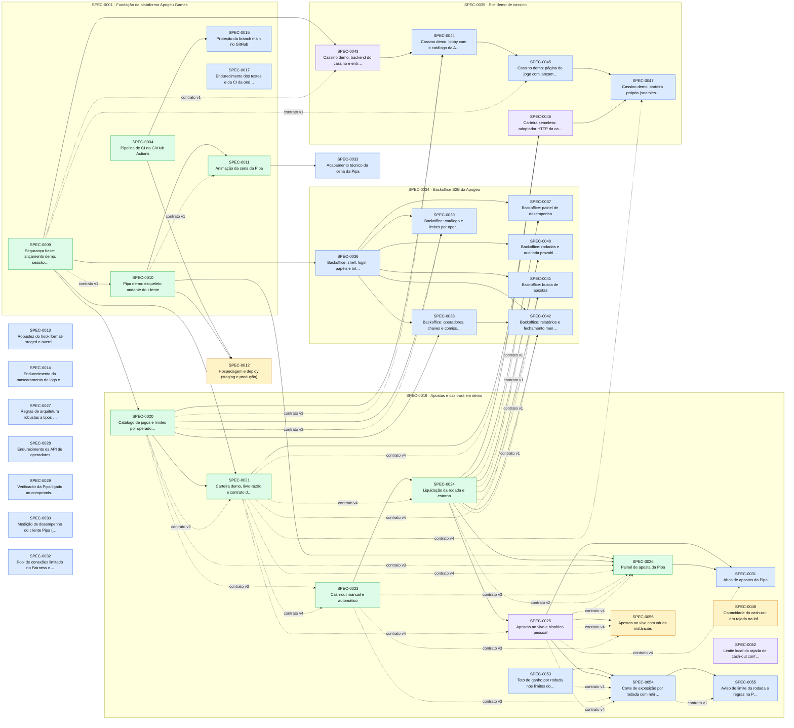

# Índice de Specs

> Gerado por `spec_graph.py index` em 2026-10-13 — não edite manualmente.

## Saúde

- Validação (G0): **2 erro(s), 19 aviso(s)** — rode `spec_graph.py validate`
- Specs: proposed 3, approved 24, in-progress 4, implemented 21
- Impedimentos: **1 aberto(s)**, 19 resolvido(s)

## Impedimentos Abertos

| Spec | ID | Tipo | Fase/Gate | Responsável | Aberto em | Idade | Descrição |
|---|---|---|---|---|---|---|---|
| SPEC-0015 | IMP-01 | externo | G1 | thomas: GitHub Pro ou repositório público | 2026-10-09 | 4d | Branch protection e rulesets indisponíveis no GitHub Free para repositório privado (API 403) |

## Cobertura de Pilares

Perfil: **rigoroso**

| Pilar | Situação | Detalhe |
|---|---|---|
| Arquitetura e fronteiras | coberto | ADR-0001, ADR-0004 |
| Estratégia de testes | coberto | ADR-0009 |
| Qualidade de código | coberto | ADR-0012 |
| Entrega contínua e ambientes | coberto | ADR-0013 |
| Fluxo de mudança | coberto | ADR-0011 |
| Segredos e dados sensíveis | coberto | ADR-0014 |
| Identidade e acesso | coberto | ADR-0015 |
| Dependências e ciclo de vida da stack | coberto | ADR-0016, ADR-0022 |
| Observabilidade | coberto | ADR-0017 |
| Resiliência e recuperação | coberto | ADR-0018 |
| Dados e migrações | coberto | ADR-0010 |
| Custo | dispensado | Fase pessoal só com validação local, sem hospedagem nem serviços pagos (decisão do usuário, 2026-10-07). Reabrir na spec 'Hospedagem e deploy' com estimativa atual/2x/10x. |
| Desempenho e escala | coberto | ADR-0019 |
| Acessibilidade e conformidade | coberto | ADR-0020 |

## Jornadas Críticas

| Jornada | Situação | Specs |
|---|---|---|
| Jogador abre o jogo pelo operador, aposta e faz cash-out antes do crash, com saldo atualizado na carteira | provada | SPEC-0026 |
| Jogador aposta, a rodada crasha antes do cash-out e a aposta é liquidada como perdida | provada | SPEC-0026 |
| Jogador verifica uma rodada encerrada pelo hash/semente e obtém o mesmo ponto de crash | provada | SPEC-0010 |

## Plano de Execução

**Em andamento:** SPEC-0025, SPEC-0043, SPEC-0046, SPEC-0052  
**Paradas por impedimento:** —  
**Próximo lote:** —

| Onda | Spec | Título | Tier/Tam. | Status | Prontidão | Observação |
|---|---|---|---|---|---|---|
| 1 | SPEC-0025 | Apostas ao vivo e histórico pessoal | full/M | in-progress | 🔄 em andamento |  |
| 1 | SPEC-0043 | Cassino demo: backend do cassino e entrada | full/M | in-progress | 🔄 em andamento |  |
| 1 | SPEC-0013 | Robustez do hook format-staged e override de peer do jsx-a11y | lite/S | approved | ✅ pronta |  |
| 2 | SPEC-0046 | Carteira seamless: adaptador HTTP da carteira do operador | full/M | in-progress | 🔄 em andamento | saiu da onda 1: arquivos em comum com SPEC-0025 |
| 2 | SPEC-0052 | Limite local da rajada de cash-out configurável por máquina | lite/S | in-progress | 🔄 em andamento | saiu da onda 1: arquivos em comum com SPEC-0025 |
| 2 | SPEC-0014 | Endurecimento do mascaramento de logs e health checks | lite/S | approved | ✅ pronta | saiu da onda 1: max_parallel=3 |
| 3 | SPEC-0015 | Proteção da branch main no GitHub | lite/S | approved | ⛔ impedimento IMP-01 (externo → thomas: GitHub Pro ou repositório público, 4d) | saiu da onda 1: arquivos em comum com SPEC-0043; saiu da onda 2: max_parallel=3 |
| 3 | SPEC-0027 | Regras de arquitetura robustas a tipos gerados e regra do hub sem regra de negócio | lite/S | approved | ✅ pronta | saiu da onda 1: arquivos em comum com SPEC-0043; saiu da onda 2: max_parallel=3 |
| 3 | SPEC-0028 | Endurecimento da API de operadores | lite/S | approved | ✅ pronta | saiu da onda 1: arquivos em comum com SPEC-0025; saiu da onda 2: arquivos em comum com SPEC-0046 |
| 4 | SPEC-0017 | Endurecimento dos testes e da CI da onda 3 | lite/S | approved | ✅ pronta | saiu da onda 1: max_parallel=3; saiu da onda 2: max_parallel=3; saiu da onda 3: arquivos em comum com SPEC-0015 |
| 4 | SPEC-0029 | Verificador da Pipa ligado ao compromisso exibido ao vivo | lite/S | approved | ✅ pronta | saiu da onda 1: max_parallel=3; saiu da onda 2: max_parallel=3; saiu da onda 3: max_parallel=3 |
| 4 | SPEC-0032 | Pool de conexões limitado no Fairness e no Operators | lite/S | approved | ✅ pronta | saiu da onda 1: arquivos em comum com SPEC-0025; saiu da onda 2: max_parallel=3; saiu da onda 3: arquivos em comum com SPEC-0028 |
| 5 | SPEC-0030 | Medição de desempenho do cliente Pipa (Lighthouse mobile e 60 fps) | lite/S | approved | ✅ pronta | saiu da onda 1: arquivos em comum com SPEC-0043; saiu da onda 2: max_parallel=3; saiu da onda 3: arquivos em comum com SPEC-0015; saiu da onda 4: arquivos em comum com SPEC-0017, SPEC-0029 |
| 5 | SPEC-0031 | Abas de apostas da Pipa | lite/S | approved | ⛔ aguarda implementação de SPEC-0025 | saiu da onda 2: max_parallel=3; saiu da onda 3: max_parallel=3; saiu da onda 4: arquivos em comum com SPEC-0029 |
| 5 | SPEC-0033 | Acabamento técnico da cena da Pipa | lite/S | approved | ✅ pronta | saiu da onda 1: max_parallel=3; saiu da onda 2: max_parallel=3; saiu da onda 3: max_parallel=3; saiu da onda 4: arquivos em comum com SPEC-0029 |
| 6 | SPEC-0036 | Backoffice: shell, login, papéis e trilha de auditoria | full/M | approved | ✅ pronta | saiu da onda 1: max_parallel=3; saiu da onda 2: max_parallel=3; saiu da onda 3: max_parallel=3; saiu da onda 4: arquivos em comum com SPEC-0029; saiu da onda 5: arquivos em comum com SPEC-0031 |
| 6 | SPEC-0044 | Cassino demo: lobby com o catálogo da Apogeu | full/M | approved | ⛔ aguarda implementação de SPEC-0043 | saiu da onda 2: max_parallel=3; saiu da onda 3: arquivos em comum com SPEC-0028; saiu da onda 4: arquivos em comum com SPEC-0032; saiu da onda 5: max_parallel=3 |
| 6 | SPEC-0012 | Hospedagem e deploy (staging e produção) | full/M | proposed | ⏳ aguardando aprovação (H1) | saiu da onda 1: max_parallel=3; saiu da onda 2: max_parallel=3; saiu da onda 3: max_parallel=3; saiu da onda 4: max_parallel=3; saiu da onda 5: max_parallel=3 |
| 7 | SPEC-0037 | Backoffice: painel de desempenho | full/M | approved | ⛔ aguarda implementação de SPEC-0036; contrato de SPEC-0024 mudou (v1 → v2): revisar spec |  |
| 7 | SPEC-0045 | Cassino demo: página do jogo com lançamento assinado | full/M | approved | ⛔ aguarda implementação de SPEC-0044 |  |
| 7 | SPEC-0053 | Teto de ganho por rodada nos limites do operador | full/S | approved | ✅ pronta | saiu da onda 1: arquivos em comum com SPEC-0025; saiu da onda 2: arquivos em comum com SPEC-0046; saiu da onda 3: arquivos em comum com SPEC-0028; saiu da onda 4: arquivos em comum com SPEC-0032; saiu da onda 5: max_parallel=3; saiu da onda 6: arquivos em comum com SPEC-0044 |
| 8 | SPEC-0038 | Backoffice: operadores, chaves e comissão | full/M | approved | ⛔ aguarda implementação de SPEC-0036 | saiu da onda 7: arquivos em comum com SPEC-0037 |
| 8 | SPEC-0047 | Cassino demo: carteira própria (seamless) | full/M | approved | ⛔ aguarda implementação de SPEC-0045; aguarda implementação de SPEC-0046 |  |
| 8 | SPEC-0054 | Corte de exposição por rodada com retirada automática | full/M | approved | ⛔ aguarda implementação de SPEC-0053; aguarda implementação de SPEC-0025 |  |
| 9 | SPEC-0039 | Backoffice: catálogo e limites por operador | full/M | approved | ⛔ aguarda implementação de SPEC-0036 | saiu da onda 7: arquivos em comum com SPEC-0037; saiu da onda 8: arquivos em comum com SPEC-0038 |
| 9 | SPEC-0055 | Aviso de limite da rodada e regras na Pipa | lite/S | approved | ⛔ aguarda implementação de SPEC-0054 |  |
| 9 | SPEC-0048 | Capacidade do cash-out em rajada na infraestrutura real | lite/S | proposed | ⏳ aguardando aprovação (H1) | saiu da onda 1: arquivos em comum com SPEC-0025; saiu da onda 2: arquivos em comum com SPEC-0046, SPEC-0052; saiu da onda 3: max_parallel=3; saiu da onda 4: max_parallel=3; saiu da onda 5: max_parallel=3; saiu da onda 6: max_parallel=3; saiu da onda 7: arquivos em comum com SPEC-0037, SPEC-0053; saiu da onda 8: arquivos em comum com SPEC-0054 |
| 10 | SPEC-0040 | Backoffice: rodadas e auditoria provably fair | full/M | approved | ⛔ aguarda implementação de SPEC-0036; contrato de SPEC-0024 mudou (v1 → v2): revisar spec | saiu da onda 7: arquivos em comum com SPEC-0037; saiu da onda 8: arquivos em comum com SPEC-0038; saiu da onda 9: arquivos em comum com SPEC-0039 |
| 11 | SPEC-0041 | Backoffice: busca de apostas | full/M | approved | ⛔ aguarda implementação de SPEC-0036; contrato de SPEC-0024 mudou (v1 → v2): revisar spec | saiu da onda 7: arquivos em comum com SPEC-0037; saiu da onda 8: arquivos em comum com SPEC-0038; saiu da onda 9: arquivos em comum com SPEC-0039; saiu da onda 10: arquivos em comum com SPEC-0040 |
| 12 | SPEC-0042 | Backoffice: relatórios e fechamento mensal | full/M | approved | ⛔ aguarda implementação de SPEC-0036; aguarda implementação de SPEC-0038; contrato de SPEC-0024 mudou (v1 → v2): revisar spec | saiu da onda 9: arquivos em comum com SPEC-0039; saiu da onda 10: arquivos em comum com SPEC-0040; saiu da onda 11: arquivos em comum com SPEC-0041 |
| 13 | SPEC-0056 | Apostas ao vivo com várias instâncias | full/M | proposed | ⏳ aguardando aprovação (H1) | saiu da onda 2: arquivos em comum com SPEC-0046, SPEC-0052; saiu da onda 3: max_parallel=3; saiu da onda 4: max_parallel=3; saiu da onda 5: max_parallel=3; saiu da onda 6: max_parallel=3; saiu da onda 7: arquivos em comum com SPEC-0037, SPEC-0053; saiu da onda 8: arquivos em comum com SPEC-0054; saiu da onda 9: arquivos em comum com SPEC-0048; saiu da onda 10: arquivos em comum com SPEC-0040; saiu da onda 11: arquivos em comum com SPEC-0041; saiu da onda 12: arquivos em comum com SPEC-0042 |

## Épicos

| Épico | Título | Status | Progresso |
|---|---|---|---|
| SPEC-0001 | Fundação da plataforma Apogeu Games | approved | 14/16 implementadas |
| SPEC-0019 | Apostas e cash-out em demo | approved | 7/15 implementadas |
| SPEC-0034 | Backoffice B2B da Apogeu | approved | 0/7 implementadas |
| SPEC-0035 | Site demo de cassino | approved | 0/5 implementadas |

## Grafo de Dependências

Seta contínua: depende da implementação. Seta tracejada: consome contrato.

## Todas as Specs

| ID | Título | Tier | Tipo | Status | Criada | Épico | Depende de | Consome contrato |
|---|---|---|---|---|---|---|---|---|
| [SPEC-0001](SPEC-0001-fundacao.md) | Fundação da plataforma Apogeu Games | epic | foundation | approved | 2026-10-07 | — | — | — |
| [SPEC-0002](SPEC-0002-estrutura-repositorio.md) | Estrutura do repositório e qualidade de código | full | foundation | implemented | 2026-10-07 | SPEC-0001 | — | — |
| [SPEC-0003](SPEC-0003-harness-testes.md) | Harness de testes e testes de arquitetura | full | foundation | implemented | 2026-10-07 | SPEC-0001 | SPEC-0002 | — |
| [SPEC-0004](SPEC-0004-pipeline-ci.md) | Pipeline de CI no GitHub Actions | full | foundation | implemented | 2026-10-07 | SPEC-0001 | SPEC-0002, SPEC-0003 | SPEC-0006@1 |
| [SPEC-0005](SPEC-0005-ambiente-aspire.md) | Ambiente local com Aspire e observabilidade base | full | foundation | implemented | 2026-10-07 | SPEC-0001 | SPEC-0002 | — |
| [SPEC-0006](SPEC-0006-contratos-gerados.md) | Contratos gerados do backend para o front-end | full | foundation | implemented | 2026-10-07 | SPEC-0001 | SPEC-0002 | — |
| [SPEC-0007](SPEC-0007-fairness.md) | Justiça do resultado: cadeia de sementes e ponto de crash | full | foundation | implemented | 2026-10-07 | SPEC-0001 | SPEC-0003 | — |
| [SPEC-0008](SPEC-0008-motor-rodada.md) | Motor de rodada e salas em tempo real | full | foundation | implemented | 2026-10-07 | SPEC-0001 | SPEC-0003, SPEC-0005 | SPEC-0007@2 |
| [SPEC-0009](SPEC-0009-seguranca-base.md) | Segurança base: lançamento demo, sessão do jogador e acesso | full | foundation | implemented | 2026-10-07 | SPEC-0001 | SPEC-0003, SPEC-0005 | — |
| [SPEC-0010](SPEC-0010-pipa-esqueleto.md) | Pipa demo: esqueleto andante do cliente | full | foundation | implemented | 2026-10-07 | SPEC-0001 | SPEC-0005, SPEC-0006 | SPEC-0007@2, SPEC-0008@3, SPEC-0009@1 |
| [SPEC-0011](SPEC-0011-animacao-pipa.md) | Animação da cena da Pipa | full | feature | implemented | 2026-10-07 | SPEC-0001 | SPEC-0010 | SPEC-0010@1 |
| [SPEC-0012](SPEC-0012-hospedagem-deploy.md) | Hospedagem e deploy (staging e produção) | full | foundation | proposed | 2026-10-07 | — | SPEC-0004, SPEC-0010 | — |
| [SPEC-0013](SPEC-0013-debitos-ferramentas-locais.md) | Robustez do hook format-staged e override de peer do jsx-a11y | lite | fix | approved | 2026-10-08 | — | — | — |
| [SPEC-0014](SPEC-0014-endurecimento-observabilidade.md) | Endurecimento do mascaramento de logs e health checks | lite | fix | approved | 2026-10-08 | — | — | — |
| [SPEC-0015](SPEC-0015-protecao-da-branch-main-no-github.md) | Proteção da branch main no GitHub | lite | feature | approved | 2026-10-08 | SPEC-0001 | SPEC-0004 | — |
| [SPEC-0016](SPEC-0016-mutacao-com-stryker-net-e-xunit-v3.md) | Mutação com Stryker.NET e xUnit v3 | lite | fix | implemented | 2026-10-08 | SPEC-0001 | — | — |
| [SPEC-0017](SPEC-0017-endurecimento-dos-testes-e-da-ci-da-onda-3.md) | Endurecimento dos testes e da CI da onda 3 | lite | refactor | approved | 2026-10-08 | SPEC-0001 | — | — |
| [SPEC-0018](SPEC-0018-som-da-pipa.md) | Som da Pipa | full | feature | implemented | 2026-10-09 | SPEC-0001 | SPEC-0011 | SPEC-0010@1 |
| [SPEC-0019](SPEC-0019-apostas-cashout-demo.md) | Apostas e cash-out em demo | epic | feature | approved | 2026-10-09 | — | SPEC-0001 | — |
| [SPEC-0020](SPEC-0020-catalogo-jogos.md) | Catálogo de jogos e limites por operador e moeda | full | feature | implemented | 2026-10-07 | SPEC-0019 | SPEC-0009 | — |
| [SPEC-0021](SPEC-0021-carteira-demo.md) | Carteira demo, livro-razão e contrato da carteira do operador | full | feature | implemented | 2026-10-07 | SPEC-0019 | SPEC-0009, SPEC-0020 | SPEC-0020@3 |
| [SPEC-0022](SPEC-0022-apostar.md) | Apostar, aposta dupla e cancelamento | full | feature | implemented | 2026-10-07 | SPEC-0019 | SPEC-0008, SPEC-0009 | SPEC-0020@3, SPEC-0021@4 |
| [SPEC-0023](SPEC-0023-cashout.md) | Cash-out manual e automático | full | feature | implemented | 2026-10-07 | SPEC-0019 | SPEC-0022 | SPEC-0020@3, SPEC-0021@4 |
| [SPEC-0024](SPEC-0024-liquidacao.md) | Liquidação da rodada e estorno | full | feature | implemented | 2026-10-07 | SPEC-0019 | SPEC-0023 | SPEC-0021@4 |
| [SPEC-0025](SPEC-0025-apostas-ao-vivo.md) | Apostas ao vivo e histórico pessoal | full | feature | in-progress | 2026-10-07 | SPEC-0019 | SPEC-0024 | SPEC-0021@4 |
| [SPEC-0026](SPEC-0026-painel-aposta-pipa.md) | Painel de aposta da Pipa | full | feature | implemented | 2026-10-07 | SPEC-0019 | SPEC-0010, SPEC-0024 | SPEC-0020@3, SPEC-0021@4, SPEC-0022@3, SPEC-0023@3, SPEC-0024@2, SPEC-0025@4 |
| [SPEC-0027](SPEC-0027-regras-arquitetura-onda4.md) | Regras de arquitetura robustas a tipos gerados e regra do hub sem regra de negócio | lite | fix | approved | 2026-10-09 | — | — | — |
| [SPEC-0028](SPEC-0028-endurecimento-api-operadores.md) | Endurecimento da API de operadores | lite | fix | approved | 2026-10-09 | — | — | — |
| [SPEC-0029](SPEC-0029-verificador-ligado-compromisso.md) | Verificador da Pipa ligado ao compromisso exibido ao vivo | lite | fix | approved | 2026-10-09 | — | — | — |
| [SPEC-0030](SPEC-0030-medicao-desempenho-pipa.md) | Medição de desempenho do cliente Pipa (Lighthouse mobile e 60 fps) | lite | fix | approved | 2026-10-09 | — | — | — |
| [SPEC-0031](SPEC-0031-abas-apostas-pipa.md) | Abas de apostas da Pipa | lite | feature | approved | 2026-10-09 | SPEC-0019 | SPEC-0025, SPEC-0026 | SPEC-0025@4 |
| [SPEC-0032](SPEC-0032-pool-limitado-fairness-operators.md) | Pool de conexões limitado no Fairness e no Operators | lite | fix | approved | 2026-10-09 | — | — | — |
| [SPEC-0033](SPEC-0033-acabamento-cena-pipa.md) | Acabamento técnico da cena da Pipa | lite | refactor | approved | 2026-10-10 | — | SPEC-0011 | — |
| [SPEC-0034](SPEC-0034-backoffice-b2b.md) | Backoffice B2B da Apogeu | epic | feature | approved | 2026-10-10 | — | SPEC-0019 | — |
| [SPEC-0035](SPEC-0035-site-demo-de-cassino.md) | Site demo de cassino | epic | feature | approved | 2026-10-10 | — | SPEC-0019 | — |
| [SPEC-0036](SPEC-0036-backoffice-shell-papeis-auditoria.md) | Backoffice: shell, login, papéis e trilha de auditoria | full | feature | approved | 2026-10-10 | SPEC-0034 | SPEC-0009 | — |
| [SPEC-0037](SPEC-0037-backoffice-painel.md) | Backoffice: painel de desempenho | full | feature | approved | 2026-10-10 | SPEC-0034 | SPEC-0036, SPEC-0024 | SPEC-0024@1 |
| [SPEC-0038](SPEC-0038-backoffice-operadores.md) | Backoffice: operadores, chaves e comissão | full | feature | approved | 2026-10-10 | SPEC-0034 | SPEC-0036, SPEC-0020 | — |
| [SPEC-0039](SPEC-0039-backoffice-catalogo.md) | Backoffice: catálogo e limites por operador | full | feature | approved | 2026-10-10 | SPEC-0034 | SPEC-0036, SPEC-0020 | SPEC-0020@3 |
| [SPEC-0040](SPEC-0040-backoffice-rodadas.md) | Backoffice: rodadas e auditoria provably fair | full | feature | approved | 2026-10-10 | SPEC-0034 | SPEC-0036, SPEC-0024 | SPEC-0024@1 |
| [SPEC-0041](SPEC-0041-backoffice-apostas.md) | Backoffice: busca de apostas | full | feature | approved | 2026-10-10 | SPEC-0034 | SPEC-0036, SPEC-0024 | SPEC-0024@1, SPEC-0021@4 |
| [SPEC-0042](SPEC-0042-backoffice-relatorios.md) | Backoffice: relatórios e fechamento mensal | full | feature | approved | 2026-10-10 | SPEC-0034 | SPEC-0036, SPEC-0038, SPEC-0024 | SPEC-0024@1 |
| [SPEC-0043](SPEC-0043-demo-cassino-entrada.md) | Cassino demo: backend do cassino e entrada | full | feature | in-progress | 2026-10-10 | SPEC-0035 | SPEC-0009 | SPEC-0009@1 |
| [SPEC-0044](SPEC-0044-demo-cassino-lobby.md) | Cassino demo: lobby com o catálogo da Apogeu | full | feature | approved | 2026-10-10 | SPEC-0035 | SPEC-0043, SPEC-0020 | SPEC-0020@3 |
| [SPEC-0045](SPEC-0045-demo-cassino-jogo.md) | Cassino demo: página do jogo com lançamento assinado | full | feature | approved | 2026-10-10 | SPEC-0035 | SPEC-0044 | SPEC-0009@1 |
| [SPEC-0046](SPEC-0046-carteira-seamless-adaptador.md) | Carteira seamless: adaptador HTTP da carteira do operador | full | feature | in-progress | 2026-10-10 | SPEC-0035 | SPEC-0021, SPEC-0024 | SPEC-0021@4 |
| [SPEC-0047](SPEC-0047-demo-cassino-carteira.md) | Cassino demo: carteira própria (seamless) | full | feature | approved | 2026-10-10 | SPEC-0035 | SPEC-0045, SPEC-0046 | SPEC-0021@4 |
| [SPEC-0048](SPEC-0048-capacidade-do-cash-out-em-rajada-na-infraestrutura-real.md) | Capacidade do cash-out em rajada na infraestrutura real | lite | refactor | proposed | 2026-10-11 | SPEC-0019 | — | — |
| [SPEC-0049](SPEC-0049-multiplicador-da-pipa-no-topo-da-cena-sem-cobrir-a-pipa.md) | Multiplicador da Pipa no topo da cena, sem cobrir a pipa | lite | fix | implemented | 2026-10-12 | SPEC-0019 | — | — |
| [SPEC-0050](SPEC-0050-acesso-ao-jogo-local-pelo-celular-via-tunel.md) | Acesso ao jogo local pelo celular via túnel | lite | feature | implemented | 2026-10-12 | SPEC-0001 | — | — |
| [SPEC-0051](SPEC-0051-gates-locais-so-com-os-testes-afetados-pela-mudanca.md) | Gates locais só com os testes afetados pela mudança | lite | refactor | implemented | 2026-10-12 | SPEC-0001 | — | — |
| [SPEC-0052](SPEC-0052-limite-local-da-rajada-de-cash-out-configuravel-por-maquina.md) | Limite local da rajada de cash-out configurável por máquina | lite | fix | in-progress | 2026-10-13 | SPEC-0019 | — | — |
| [SPEC-0053](SPEC-0053-teto-de-ganho-por-rodada-nos-limites-do-operador.md) | Teto de ganho por rodada nos limites do operador | full | feature | approved | 2026-10-13 | SPEC-0019 | — | — |
| [SPEC-0054](SPEC-0054-corte-de-exposicao-por-rodada-com-retirada-automatica.md) | Corte de exposição por rodada com retirada automática | full | feature | approved | 2026-10-13 | SPEC-0019 | SPEC-0053, SPEC-0025 | SPEC-0053@1, SPEC-0023@3, SPEC-0025@4 |
| [SPEC-0055](SPEC-0055-aviso-de-limite-da-rodada-e-regras-na-pipa.md) | Aviso de limite da rodada e regras na Pipa | lite | feature | approved | 2026-10-13 | SPEC-0019 | SPEC-0054 | SPEC-0054@1 |
| [SPEC-0056](SPEC-0056-apostas-ao-vivo-com-varias-instancias.md) | Apostas ao vivo com várias instâncias | full | feature | proposed | 2026-10-13 | SPEC-0019 | SPEC-0025 | SPEC-0025@4, SPEC-0023@3 |

## ADRs

| ID | Título | Status | Garantido por (G3) |
|---|---|---|---|
| [ADR-0001](../adr/ADR-0001-backend-monolito-modular.md) | Backend em monólito modular com vertical slices | accepted | Testes de arquitetura (ArchUnitNET) em tests/Architecture.Tests, categoria Architecture, no CI (G3) |
| [ADR-0002](../adr/ADR-0002-runtime-dotnet10-wolverine.md) | Runtime do backend: .NET 10 LTS, ASP.NET Core e Wolverine | accepted | Teste de arquitetura proíbe referências a MediatR, AutoMapper e MassTransit; global.json fixa o SDK 10 |
| [ADR-0003](../adr/ADR-0003-aspire.md) | Orquestração local e padrões de serviço com Aspire | accepted | Teste de integração do AppHost (Aspire.Hosting.Testing) sobe o ambiente e verifica health checks |
| [ADR-0004](../adr/ADR-0004-monorepo-frontend.md) | Repositório único e arquitetura do front-end dos jogos | accepted | dependency-cruiser (src/frontend/.dependency-cruiser.cjs) no CI, categoria arquitetura |
| [ADR-0005](../adr/ADR-0005-tempo-real-salas.md) | Tempo real e salas de rodada | accepted | Testes de integração (Testcontainers Redis) para liderança e cash-out com horário do servidor; teste de arquitetura: o hub não contém regra de negócio |
| [ADR-0006](../adr/ADR-0006-provably-fair.md) | Justiça do resultado: provably fair sobre gerador criptográfico | accepted | Testes unitários com vetores conhecidos (Fairness.Tests) + simulação de RTP no CI noturno; teste de arquitetura: Fairness.Domain sem I/O |
| [ADR-0007](../adr/ADR-0007-carteira-livro-razao.md) | Carteira do operador e livro-razão | accepted | Testes de integração (Testcontainers PostgreSQL + servidor de carteira falso) para idempotência, estorno e reprocessamento; teste de arquitetura: só Wallet escreve no livro-razão |
| [ADR-0008](../adr/ADR-0008-contratos-gerados.md) | Contratos gerados do backend para o front-end | accepted | Job de CI regenera os contratos e falha se houver diferença (git diff --exit-code); testes de contrato (CT) por spec |
| [ADR-0009](../adr/ADR-0009-testes.md) | Estratégia e ferramentas de teste | accepted | Comandos test, test_integration, test_e2e e coverage do sdd-config, executados pelo gate --run e pelo CI |
| [ADR-0010](../adr/ADR-0010-dados-postgres-redis.md) | PostgreSQL e Redis, schema por módulo e migrações | accepted | Teste de integração aplica todas as migrações num PostgreSQL real (Testcontainers) e roda a versão anterior contra o schema novo; teste de arquitetura: cada DbContext só mapeia o próprio schema |
| [ADR-0011](../adr/ADR-0011-fluxo-pr.md) | Fluxo de mudança por pull request no GitHub | accepted | Proteção de branch no GitHub; change_flow: pr no sdd-config; job sdd (pr-check) obrigatório; hooks commit-msg/pre-commit |
| [ADR-0012](../adr/ADR-0012-qualidade-codigo.md) | Qualidade de código: formatadores, linters, analisadores e SAST | accepted | Job lint do CI: dotnet format --verify-no-changes, build com TreatWarningsAsErrors, pnpm lint, pnpm typecheck, prettier --check, Semgrep e gitleaks |
| [ADR-0013](../adr/ADR-0013-entrega.md) | Entrega: CI no GitHub Actions, validação local e hospedagem adiada | accepted | Workflows do GitHub Actions obrigatórios na proteção de branch; deploy_staging/deploy_production do sdd-config vazios e G6 = N/A apontando a spec de hospedagem até ela existir |
| [ADR-0014](../adr/ADR-0014-segredos-dados.md) | Segredos, sementes e dados pessoais | accepted | gitleaks no CI; teste de integração de mascaramento de logs; teste de arquitetura: sementes só acessadas pelo módulo Fairness |
| [ADR-0015](../adr/ADR-0015-identidade-acesso.md) | Identidade e acesso: Keycloak (OIDC), lançamento de jogo e API de operadores | accepted | Testes de integração de acesso negado por endpoint; teste de arquitetura: endpoints sem [Authorize]/política explícita falham; nenhuma referência a SDK de fornecedor de identidade |
| [ADR-0016](../adr/ADR-0016-dependencias.md) | Dependências, licenças e ciclo de vida da stack | accepted | security_scan no CI (dotnet list package --vulnerable, pnpm audit, gitleaks); Dependabot; verificação de licenças no CI |
| [ADR-0017](../adr/ADR-0017-observabilidade.md) | Observabilidade com OpenTelemetry e SLOs das jornadas críticas | accepted | ServiceDefaults em todo serviço (teste de arquitetura); teste de integração do health check; teste de mascaramento de dados em logs |
| [ADR-0018](../adr/ADR-0018-resiliencia.md) | Resiliência: rodada sempre termina, idempotência e recuperação | accepted | Testes de integração: queda do líder no meio do voo, timeout e duplicata da carteira, reinício do processo com outbox pendente |
| [ADR-0019](../adr/ADR-0019-desempenho-escala.md) | Metas de desempenho e escala | accepted | Teste de carga k6 com limiares (thresholds) que reprovam a execução; Lighthouse CI com orçamento de bundle no build do jogo |
| [ADR-0020](../adr/ADR-0020-acessibilidade-conformidade.md) | Acessibilidade e conformidade regulatória | accepted | @axe-core/playwright no CI para HUD e backoffice; checklist de conformidade no G4; spec de conformidade obrigatória antes de dinheiro real |
| [ADR-0021](../adr/ADR-0021-direcao-animacao.md) | Direção de animação das cenas dos jogos | accepted | Testes de regressão visual (Playwright toHaveScreenshot) dos quadros-chave; E2E de movimento reduzido; medição de tempo de quadro; dependency-cruiser: animação só via GameAnimator |
| [ADR-0022](../adr/ADR-0022-licencas-permitidas.md) | Ampliação das licenças permitidas | accepted | Verificação de licenças no CI (ferramenta escolhida na SPEC-0004) usando a lista permitida do ADR-0016 ampliada por este ADR |
| [ADR-0023](../adr/ADR-0023-recraft-para-a-arte-vetorial-dos-jogos.md) | Recraft para a arte vetorial dos jogos | accepted | Revisão no G4 da spec de arte final (licença do plano e origem de cada asset registradas); regressão visual do ADR-0021 com imagens de referência aprovadas pelo usuário |
| [ADR-0024](../adr/ADR-0024-audio-dos-jogos-com-web-audio-nativa-e-efeitos-cc0.md) | Áudio dos jogos com Web Audio nativa e efeitos CC0 | accepted | dependency-cruiser: só o scene-kit acessa AudioContext (áudio via GameAudio); revisão no G4 do registro de origem e da licença CC0 de cada arquivo em public/audio; orçamento de pacote no CI |
| [ADR-0025](../adr/ADR-0025-identidade-visual-apogeu-e-design-systems-derivados.md) | Identidade visual Apogeu e design systems derivados | accepted | Tokens de cor e tipografia num pacote único do front (fonte única por produto); teste de contraste WCAG 2.2 AA dos tokens; revisão visual no G4 contra a tela aprovada no Stitch |
| [ADR-0026](../adr/ADR-0026-papeis-escopo-de-dados-e-trilha-de-auditoria-do-backoffice.md) | Papéis, escopo de dados e trilha de auditoria do backoffice | accepted | Teste de arquitetura: todo endpoint /api/backoffice/* declara política de papel; IT por tela provando que usuário de operador só vê o próprio operador; trigger que recusa UPDATE/DELETE na trilha de auditoria |
| [ADR-0027](../adr/ADR-0027-cassino-demo-como-operador-externo.md) | Cassino demo como operador externo | accepted | Teste de arquitetura: o projeto do cassino demo não referencia nenhum projeto da Apogeu (só HTTP); teste de build: nenhum segredo HMAC no bundle do navegador |
| [ADR-0028](../adr/ADR-0028-operacao-do-wolverine-geracao-de-codigo-ciclo-de-vida-e-arma.md) | Operação do Wolverine: geração de código, ciclo de vida e armazenamento | accepted | CI roda `codegen write` e falha se `git diff --exit-code` em Host/Internal/Generated acusar diferença (código gerado atualizado); teste de arquitetura: só o Host configura o Wolverine e nenhum módulo para/inicia seus hosted services; IT de arranque com banco indisponível |
