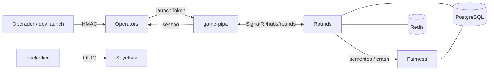

# SPEC-0001 — Fundação da plataforma Apogeu Games (Épico)

## 1. Visão
Ao final, a Apogeu Games tem um repositório único com qualidade e testes bloqueantes, CI no GitHub, ambiente local completo com um comando (Aspire) e um **esqueleto andante**. Nele, um jogador entra na **Pipa em modo demo** pelo fluxo de lançamento de operador, acompanha rodadas reais geradas por um motor justo e verificável (provably fair) e confere qualquer rodada no próprio navegador. É a base sobre a qual entram apostas, cash-out e carteira (épico seguinte) e os próximos jogos.

## 2. Escopo
**Objetivos (dentro do escopo):**
- Estrutura do repositório, qualidade de código e controle SDD (SPEC-0002).
- Harness de testes e testes de arquitetura nas duas stacks (SPEC-0003).
- CI no GitHub Actions com proteção da `main` (SPEC-0004).
- Ambiente local com Aspire e observabilidade base (SPEC-0005).
- Contratos gerados do backend para o front (SPEC-0006).
- Justiça do resultado: cadeia de sementes e ponto de crash (SPEC-0007).
- Motor de rodada e salas em tempo real (SPEC-0008).
- Segurança base: lançamento demo, sessão do jogador, backoffice com Keycloak (SPEC-0009).
- Cliente Pipa demo de ponta a ponta (SPEC-0010).
- Animação bonita da cena da Pipa, com regressão visual aprovada pelo usuário (SPEC-0011, emenda v2).

**Não-objetivos (fora do escopo):**
- Apostas, cash-out, carteira e livro-razão (próximo épico: "Apostas e cash-out em demo", que provará as jornadas aposta-cashout e aposta-perdida).
- Telas do backoffice e site demo (só o esqueleto dos apps).
- Hospedagem, staging e produção (spec futura "Hospedagem e deploy", ADR-0013).
- Conformidade regulatória para dinheiro real (spec obrigatória antes do dinheiro real, ADR-0020).
- Arte final ilustrada, Spine, som, chat, apostas ao vivo de outros jogadores, outros jogos.

## 3. Arquitetura Alvo
**Contexto:** projeto novo; stack e arquitetura definidas nos ADRs de fundação ADR-0001 a ADR-0020 (todos propostos junto com este épico).

Monólito modular .NET 10 (módulos Rounds, Fairness, Betting, Wallet, Operators, Backoffice, cada um com `Contracts` público e vertical slices) hospedado num único Host, com PostgreSQL (schema por módulo) e Redis (líder por sala, backplane SignalR). Front em workspace pnpm: `game-sdk` (rede + estado) → `game-ui` (HUD React) / `scene-kit` (PixiJS + `GameAnimator`) → `apps/game-pipa`. Contratos TS gerados do backend. Tudo orquestrado localmente pelo Aspire com OpenTelemetry.

**Decisões (ADRs):** ADR-0001 monólito modular; ADR-0002 .NET 10 + Wolverine; ADR-0003 Aspire; ADR-0004 monorepo e front; ADR-0005 tempo real e salas; ADR-0006 provably fair; ADR-0007 carteira e livro-razão (aplicada no próximo épico); ADR-0008 contratos gerados; ADR-0009 testes; ADR-0010 dados; ADR-0011 fluxo por PR; ADR-0012 qualidade de código; ADR-0013 entrega; ADR-0014 segredos; ADR-0015 identidade; ADR-0016 dependências; ADR-0017 observabilidade; ADR-0018 resiliência; ADR-0019 desempenho; ADR-0020 acessibilidade e conformidade; ADR-0021 direção de animação (emenda v2).

**Regras de arquitetura a garantir (G3):** módulos só se comunicam por `Contracts` (ArchUnitNET); `Fairness.Domain` sem I/O e sem `System.Random`; pacotes proibidos (MediatR, AutoMapper, MassTransit); dinheiro nunca em `double`/`float`; cena do front não importa rede, e `packages/contracts` só gerado (dependency-cruiser); todo Host com ServiceDefaults; todo endpoint com política explícita.

## 4. Decomposição
| Spec | Título | Tier | Tipo | Tamanho | Depende de | Consome contrato de |
|---|---|---|---|---|---|---|
| SPEC-0002 | Estrutura do repositório e qualidade de código | full | foundation | M | — | — |
| SPEC-0003 | Harness de testes e testes de arquitetura | full | foundation | M | SPEC-0002 | — |
| SPEC-0004 | Pipeline de CI no GitHub Actions | full | foundation | M | SPEC-0002, SPEC-0003 | SPEC-0006@1 |
| SPEC-0005 | Ambiente local com Aspire e observabilidade base | full | foundation | M | SPEC-0002 | — |
| SPEC-0006 | Contratos gerados do backend para o front-end | full | foundation | M | SPEC-0002 | — |
| SPEC-0007 | Justiça do resultado: cadeia de sementes e ponto de crash | full | foundation | M | SPEC-0003 | — |
| SPEC-0008 | Motor de rodada e salas em tempo real | full | foundation | M | SPEC-0003, SPEC-0005 | SPEC-0007@1 |
| SPEC-0009 | Segurança base: lançamento demo, sessão do jogador e acesso | full | foundation | M | SPEC-0003, SPEC-0005 | — |
| SPEC-0010 | Pipa demo: esqueleto andante do cliente | full | foundation | M | SPEC-0005, SPEC-0006 | SPEC-0007@1, SPEC-0008@1, SPEC-0009@1 |
| SPEC-0011 | Animação da cena da Pipa | full | feature | M | SPEC-0010 | SPEC-0010@1 |

## 5. Estratégia de Entrega
- **Ambientes:** apenas local (Aspire) e CI; sem staging/produção nesta fase (ADR-0013).
- **Entrega por onda:** cada onda termina com PRs integrados na `main` e CI verde; o "deploy" (G6) fica N/A apontando para a spec futura "Hospedagem e deploy".
- **Feature flags:** N/A — modo demo é o único modo; dinheiro real bloqueado por regra (SPEC-0009).
- **Rollback:** reverter o merge commit da onda; migrações só criam schemas novos, sem dados de produção.
- **Métricas de sucesso pós-release:** suíte verde na `main`; ambiente local saudável em ≤ 90 s; teste de carga local da SPEC-0008 dentro da meta.

## 6. Riscos & Mitigações
- *Walking skeleton* sem produção: problemas de rede, TLS e latência real aparecem tarde — mitigação: spec de hospedagem logo após o épico de apostas; carga local já mede o servidor.
- Algoritmo provably fair congelado antes da certificação — mitigação: vetores públicos, mudança só por emenda; levantar exigências do laboratório na spec de conformidade.
- Ferramentas com versão não verificada nesta sessão (PixiJS, geradores de hub, linters) — mitigação: confirmar versões no G2 de cada spec, registrando fonte e data.
- Gerador de tipos dos hubs SignalR pode não suportar .NET 10 — mitigação: alternativa por reflexão prevista na SPEC-0006.
- Muitas ferramentas para uma pessoa só — mitigação: tudo automatizado no CI e no Aspire; agentes seguem os mesmos portões.

## 7. Critérios de Aceite do Épico
- [ ] Clone limpo compila front e back sem avisos — SPEC-0002:IT-01
- [ ] Violação de fronteira entre módulos reprova o build — SPEC-0003:UT-01
- [ ] PR com teste falhando é bloqueado na `main` — SPEC-0004:IT-02
- [ ] Um comando sobe o ambiente completo saudável — SPEC-0005:IT-01
- [ ] Divergência entre backend e contratos TS reprova — SPEC-0006:IT-02
- [ ] Ponto de crash reprodutível pelos vetores públicos — SPEC-0007:UT-01
- [ ] Queda do líder não duplica nem perde rodada — SPEC-0008:IT-04
- [ ] Lançamento com assinatura inválida ou em dinheiro real é recusado — SPEC-0009:IT-02
- [ ] Jogador entra na Pipa demo e acompanha uma rodada completa — SPEC-0010:E2E-02
- [ ] Jogador verifica uma rodada no navegador — SPEC-0010:E2E-03
- [ ] Quadros-chave da animação iguais às referências aprovadas pelo usuário — SPEC-0011:E2E-01
- [ ] Animação fluida (p95 ≤ 16,7 ms) e respeitando movimento reduzido — SPEC-0011:E2E-03, SPEC-0011:E2E-02

## 8. Questões em Aberto
- [x] Hospedagem agora ou depois? — Depois; validar tudo localmente por enquanto (thomas, 2026-10-07)
- [x] Login do backoffice? — Keycloak (open source, OIDC padrão, trocável por gerenciado) (thomas, 2026-10-07)
- [x] Nome da marca do provedor? — Apogeu Games (thomas, 2026-10-07)
- [x] Rodada global ou por operador? — Salas configuráveis (thomas, 2026-10-07)
- [x] Animação? — Código (PixiJS + GSAP) atrás de `GameAnimator`, Rive opcional, Spine depois (thomas, 2026-10-07)

## 9. Aprovação (H1)
Uma aprovação humana cobre o épico e as specs filhas apresentadas junto com ele. Registrada no frontmatter (`approved_by`, `approved_at`) do épico e de cada filha.

## 10. Registro de Impedimentos
| ID | Aberto em | Fase/Gate | Tipo | Descrição | Tentativas | Responsável | Resolução | Fechado em |
|---|---|---|---|---|---|---|---|---|

## 11. Relatório de Entrega

## 12. Emendas
| Versão | Data | Mudança | Motivo | Specs impactadas | Aprovado por |
|---|---|---|---|---|---|
| v2 | 2026-10-07 | Nova filha SPEC-0011 (animação da cena da Pipa) e ADR-0021 (direção de animação); 2 critérios de aceite novos | Pedido do usuário por animação bonita; lacunas encontradas na SPEC-0010 (movimento reduzido, medição de fps, efeitos do design) | SPEC-0011 (nova); SPEC-0010 inalterada | thomas (2026-10-07) |
