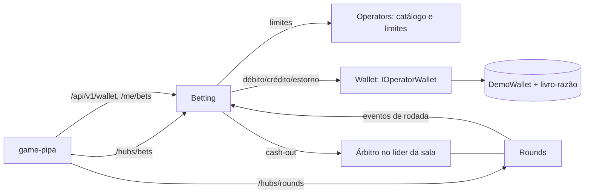

# SPEC-0019 — Apostas e cash-out em demo (Épico)

## 1. Visão
O jogador aposta na Pipa com saldo demo, retira antes do crash (manual ou automático) ou perde, e acompanha as apostas da sala e o próprio histórico. Tudo passa pelo mesmo caminho que um cassino real vai usar: carteira atrás da porta `IOperatorWallet`, livro-razão de partidas dobradas, decisão do cash-out pelo horário do servidor e liquidação auditável por rodada. Um catálogo de jogos e limites por operador e moeda deixa o próximo jogo como configuração. Ao fim, as jornadas críticas **aposta-cashout** e **aposta-perdida** estão provadas por E2E.

## 2. Escopo
**Objetivos (dentro do escopo):**
- Catálogo de jogos e limites por operador e moeda (SPEC-0020).
- Carteira demo, livro-razão e contrato público da carteira do operador (SPEC-0021).
- Apostar, aposta dupla, aposta para a próxima rodada e cancelamento (SPEC-0022).
- Cash-out manual e automático decidido pelo líder da sala (SPEC-0023).
- Liquidação da rodada, estorno de rodada anulada e resumo por rodada (SPEC-0024).
- Apostas ao vivo anonimizadas e histórico pessoal (SPEC-0025).
- Painel de aposta da Pipa com as jornadas E2E (SPEC-0026).

**Não-objetivos (fora do escopo):**
- Dinheiro real e adaptadores de carteira de cassinos e agregadores (épico futuro; dinheiro real exige a spec de conformidade, ADR-0020).
- Aposta automática repetida, "Top", chat, chuva de apostas grátis, torneios e jackpot (épico de engajamento — decisão do usuário, 2026-10-09).
- Moedas além de BRL (o modelo já é multimoeda).
- Telas de backoffice e relatórios.

## 3. Arquitetura Alvo
**Contexto:** projeto novo; segue os ADRs de fundação e as implementações de referência dos módulos Rounds, Fairness e Operators.

**Decisões (ADRs):** sem ADR novo. Aplica ADR-0007 (carteira e livro-razão), ADR-0005 (salas, horário do servidor, anonimização), ADR-0014 (crash nunca sai do líder antes do crash), ADR-0006 (justiça), ADR-0001/0002 (módulos e outbox), ADR-0019 (metas: aposta p99 ≤ 100 ms, cash-out p99 ≤ 50 ms, rajada de 300 cash-outs/s), ADR-0020 (dinheiro real bloqueado).

**Regras de arquitetura a garantir (G3):** Betting, Wallet e Operators só se falam por `Contracts`; só o Wallet escreve no livro-razão; dinheiro sempre `decimal` com moeda; cena do front não importa transporte (as apostas entram pelo store de estado).

## 4. Decomposição
| Spec | Título | Tier | Tipo | Tamanho | Depende de | Consome contrato de |
|---|---|---|---|---|---|---|
| SPEC-0020 | Catálogo de jogos e limites por operador e moeda | full | feature | M | SPEC-0009 | — |
| SPEC-0021 | Carteira demo, livro-razão e contrato da carteira do operador | full | feature | M | SPEC-0009 | — |
| SPEC-0022 | Apostar, aposta dupla e cancelamento | full | feature | M | SPEC-0008, SPEC-0009 | SPEC-0020@1, SPEC-0021@1 |
| SPEC-0023 | Cash-out manual e automático | full | feature | M | SPEC-0022 | SPEC-0020@1, SPEC-0021@1 |
| SPEC-0024 | Liquidação da rodada e estorno | full | feature | M | SPEC-0023 | SPEC-0021@1 |
| SPEC-0025 | Apostas ao vivo e histórico pessoal | full | feature | M | SPEC-0024 | SPEC-0021@1 |
| SPEC-0026 | Painel de aposta da Pipa | full | feature | M | SPEC-0010 | SPEC-0020@1 … SPEC-0025@1 |

## 5. Estratégia de Entrega
- **Ambientes:** local (Aspire) e CI; staging/produção com a SPEC-0012.
- **Entrega por onda:** cada onda integrada na `main` com G5 verde (política auto-on-green).
- **Feature flags:** N/A — só modo demo; dinheiro real bloqueado por regra.
- **Rollback:** reverter o merge commit da onda; migrações só criam schemas e tabelas novas.
- **Métricas de sucesso pós-release:** jornadas aposta-cashout e aposta-perdida verdes; aposta p99 ≤ 100 ms e cash-out p99 ≤ 50 ms nos testes de desempenho; nenhum crédito pendente por mais de 1 min.

## 6. Riscos & Mitigações
- Cadeia longa de specs no módulo Betting (0022 → 0023 → 0024 → 0025) — mitigação: o painel (0026) e a carteira (0021) avançam em paralelo com dublês dos contratos.
- Decisão do cash-out depende do líder da sala — mitigação: encaminhamento via Redis com prazo e decisão garantida até o fim da rodada; teste com duas instâncias (SPEC-0023 IT-04).
- Relógios diferentes entre instâncias — mitigação: horário de recebimento registrado pela instância que recebe, sincronização NTP; desvio medido no G4.
- E2E dependentes do resultado aleatório (crash 1,00x) — mitigação: testes tentam novas rodadas com limite (SPEC-0026 E2E-05).

## 7. Critérios de Aceite do Épico
- [ ] Jogador aposta e retira antes do crash com saldo correto — SPEC-0026:E2E-01
- [ ] Jogador aposta e perde no crash — SPEC-0026:E2E-02
- [ ] Cash-out depois do crash é recusado pelo horário do servidor — SPEC-0023:IT-01
- [ ] Débito, crédito e estorno nunca duplicam — SPEC-0021:IT-02
- [ ] Rodada anulada estorna as apostas não retiradas — SPEC-0024:IT-01
- [ ] Jogo indisponível para o operador não abre — SPEC-0020:IT-02

## 8. Questões em Aberto
- [x] Saldo inicial demo? — R$ 3.000,00 por jogador e operador, persistente, com recarga abaixo da aposta mínima; carteira real deve ser fácil de plugar (thomas, 2026-10-09)
- [x] Limites? — R$ 1,00 / R$ 1.000,00 / ganho máximo R$ 100.000,00, por operador e moeda (thomas, 2026-10-09)
- [x] Aposta dupla, próxima rodada, cancelamento, cash-out automático, tolerância zero, truncamento em centavos? — Todos como recomendado, padrão de mercado (thomas, 2026-10-09)
- [x] Apostas ao vivo e histórico? — Sim; "Top", jackpot e engajamento ficam para depois (thomas, 2026-10-09)
- [x] Moeda? — BRL agora, multimoeda em mente (thomas, 2026-10-09)
- [x] Catálogo de jogos neste épico? — Sim (thomas, 2026-10-09)

## 9. Aprovação (H1)
Uma aprovação humana cobre o épico e as specs filhas apresentadas junto com ele. Registrada no frontmatter (`approved_by`, `approved_at`) do épico e de cada filha.

## 10. Registro de Impedimentos
| ID | Aberto em | Fase/Gate | Tipo | Descrição | Tentativas | Responsável | Resolução | Fechado em |
|---|---|---|---|---|---|---|---|---|

## 11. Relatório de Entrega

## 12. Emendas
| Versão | Data | Mudança | Motivo | Specs impactadas | Aprovado por |
|---|---|---|---|---|---|
